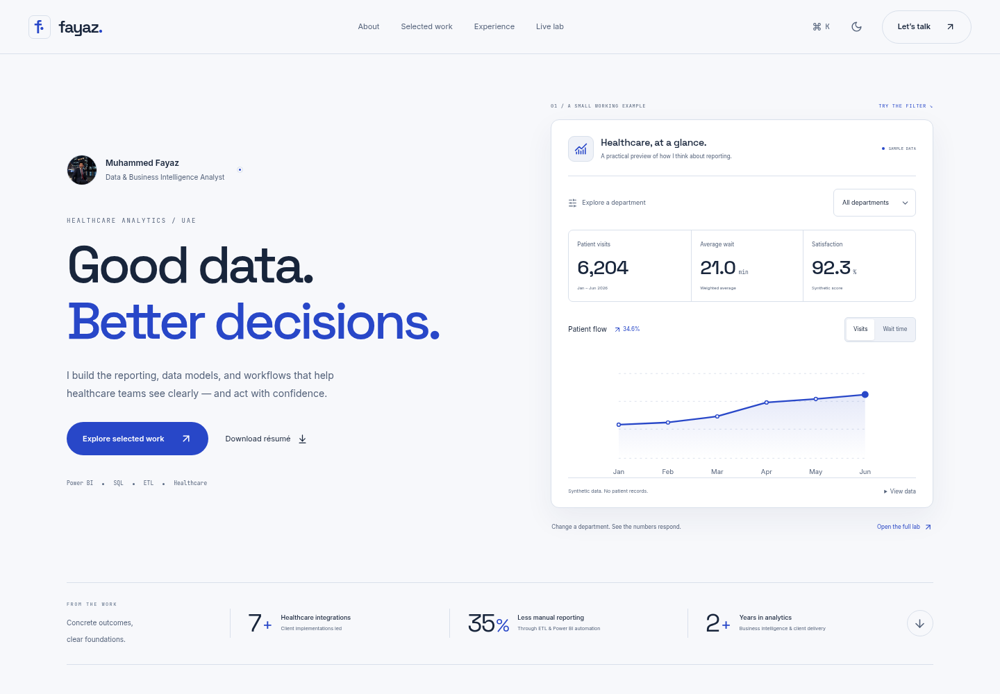

# Muhammed Fayaz — Data & BI Portfolio

A project-first portfolio built with React 18, TypeScript, Vite, styled Radix/shadcn primitives, Tailwind and an optional Recharts dashboard. The current revision replaces the rejected 3D island with lightweight, useful interactions.



## View in VS Code on Windows

Requires Node.js 22.9 or newer. Open your local `portfolioo` folder, stop an existing dev server with **Ctrl+C**, then use **Terminal → New Terminal**:

```powershell
git fetch origin
git switch feat/fayaz-portfolio
git pull origin feat/fayaz-portfolio
npm.cmd ci
npm.cmd run dev
```

Open the local address printed by Vite in your own browser, normally localhost on port 5173. `npm.cmd` avoids PowerShell's script-execution restriction without changing your execution policy. On macOS/Linux use `npm` instead of `npm.cmd`.

For the contact API during development, run `npm.cmd run dev:api` in a second terminal. Without SMTP, contact prepares an email draft and never claims successful delivery.

The existing checkout is already the development workspace. A Git worktree is unnecessary unless explicitly requested.

## What visitors can do

- Filter the opening healthcare preview by department and switch between visits/wait-time metrics. Totals and the SVG chart update from the same small synthetic dataset. A native details control exposes the underlying monthly data.
- Select one of four project case studies, using the mouse or keyboard. Each project has its own visual and an accessible full case-study route.
- Explicitly open the full dashboard to use department/date filters, chart metric selection and CSV export. Recharts loads only when requested, with chart animation disabled.
- Switch among five persisted color themes, use the command menu, download the supplied PDF résumé, and prepare a contact message.

There is no WebGL, 3D scene, animation engine, scroll pinning, animated counter or pointer-following cursor. Scroll progress updates its own element and does not rerender the application. Fonts are self-hosted Latin subsets. These are structural fixes for the reported lag, not a promise that every device will have identical performance.

## Production

```sh
npm run build
npm start
```

The cross-platform Node server renders the pages before hydration and serves route-specific metadata, static assets, sitemap, robots, contact and real HTTP 404 responses. The default port is 3001; set `PORT` on the hosting platform if needed. Set `SITE_URL` at runtime and matching `VITE_SITE_URL` at build time for a public domain. No website deployment is performed by these local setup instructions.

`vite preview` is useful for inspecting assets, but the Node server provides the complete contact and SEO behavior. A static host needs SPA rewrites and a separate API or the email-draft fallback.

## Edit content and design

- `src/data/content.ts`: profile, achievements, projects, experience, education, section copy and the opening preview copy.
- `src/data/healthcare.ts`: deterministic synthetic sample records and KPI aggregation.
- `src/components/StudioHero.tsx` and `SignalBoard.tsx`: the opening layout and dependency-light SVG preview.
- `src/components/ProjectExplorer.tsx`: accessible project selection and case-study links.
- `src/styles.css`: shared components; `src/studio.css`: current layout/theme overrides; `src/fonts.css`: self-hosted font declarations.
- `src/components/LiveLab.tsx`: the explicitly loaded Recharts dashboard.
- `public/Muhammed_Fayaz_Resume.pdf`: the supplied résumé for download.
- `public/images/`: portrait assets, including a small optimized avatar. The portrait is an AI-assisted adaptation of the supplied waterfront photograph, not an unchanged original.
- `scripts/seo.mjs`: generated metadata from the shared content. Do not edit ignored `public/route-meta.json` directly.

All healthcare data is synthetic. Project visuals are illustrations, not confidential employer screenshots. The healthcare case study is a portfolio demonstration; the other three projects come from the résumé. No clinical efficacy, invented client metrics, fake repository links or booking URLs are claimed.

## Contact configuration

Direct delivery optionally uses `SMTP_HOST`, `SMTP_PORT` (465 by default), `SMTP_FROM`, and provider-dependent `SMTP_USER`/`SMTP_PASSWORD`. Configure these privately in your hosting environment or an ignored `.env`; never commit credentials. TLS verification remains enabled; non-465 connections require STARTTLS. Without these settings, the tested workflow offers a complete email draft to send in the visitor's email app.

The API validates input and origin, limits body size, checks a honeypot/submission timing and rate-limits attempts in memory. Multi-instance hosting should use a shared rate-limit store and its documented trusted-proxy configuration. Repeated contact tests may hit the five-attempt-per-15-minute limit; restart only your local test API when necessary.

## Validate

```sh
npm test
npm run build
npm run test:browser
```

Browser tests use `/usr/bin/chromium` here; set `CHROMIUM_PATH` to an installed Chromium executable on another machine. Tests assume SMTP is unconfigured so they cannot send real mail. For an already running production server, set `TEST_BASE_URL` to its local origin before running browser tests.

See [validation](docs/VALIDATION.md), [the measured lag comparison](docs/PERFORMANCE.md) and [design notes](docs/DESIGN-RESEARCH.md).

For launch, optional real inputs remain: a public domain, SMTP provider settings for direct delivery, a calendar URL for instant booking, and original dashboard screenshots/public project repositories. Arabic localization is not implemented.
