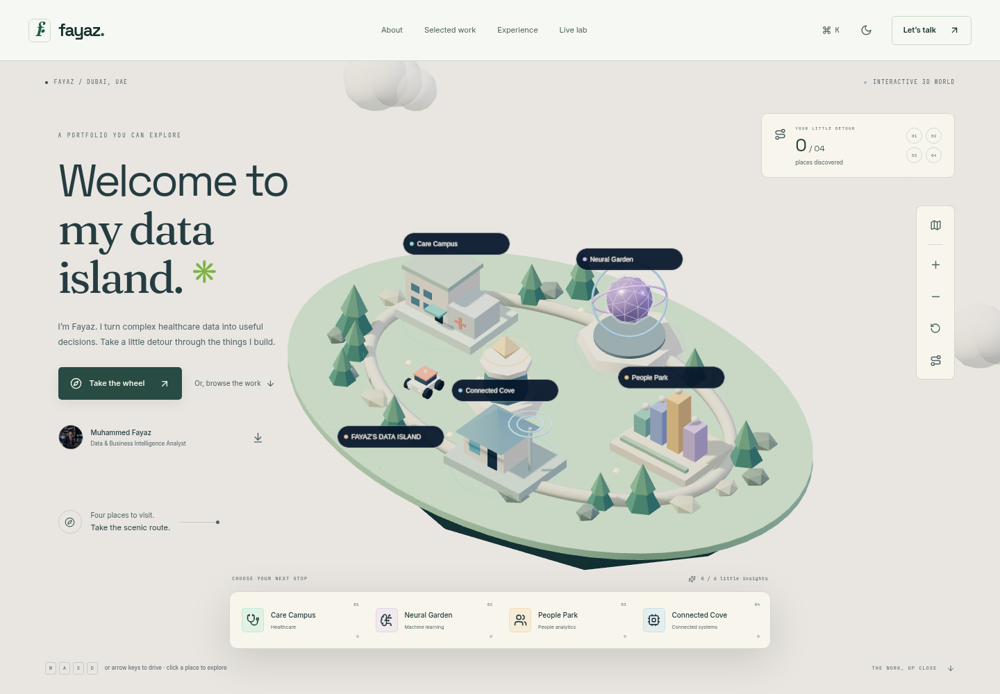

# Fayaz — Data Island

An explorable 3D personal portfolio for Muhammed Fayaz, built with React 18, TypeScript, Vite, Tailwind, styled shadcn/Radix primitives, Framer Motion, GSAP, React Three Fiber, and Recharts.



## Explore the island

- Drive the rover with **WASD or arrow keys**, click the ground to move, or use the on-screen touch controls.
- Click a building or use the destination dock to explore Care Campus, Neural Garden, People Park and Connected Cove. Each destination opens the corresponding real case study.
- Collect six small insights, discover four destinations, zoom/rotate the view, or restart the exploration.
- The project browser below the island supports tabs, arrow keys, and previous/next controls.
- Phones under 700px, reduced-motion preferences, data-saving mode and low-power devices start with the illustrated map. Visitors can explicitly enter 3D. WebGL failures return to the map; all project content stays accessible without 3D. The scene pauses when offscreen or the page is hidden.
- The procedural island and SVG map are original. See [design research](docs/DESIGN-RESEARCH.md) for the verified professional references and research limitations.

## View in Visual Studio Code

Install Node.js 22.9 or newer if `node --version` is unavailable. Open your local `portfolioo` folder in VS Code, choose **Terminal → New Terminal**, then run:

```sh
git fetch origin
git switch feat/fayaz-portfolio
git pull origin feat/fayaz-portfolio
npm.cmd ci
npm.cmd run dev
```

Open the local address printed by Vite in your own browser (normally localhost, port 5173). This example uses Windows PowerShell’s `npm.cmd` wrapper so execution-policy restrictions do not block npm. On macOS/Linux, use `npm` in place of `npm.cmd`. Run `npm run dev:api` in a second terminal to enable the contact API during development. The full production server is available with `npm run build` followed by `npm start` (port 3001).

If you have not cloned the repository, use VS Code’s **Git: Clone** command with `https://github.com/faaayaaz/portfolioo.git`, open the cloned folder, and follow the same steps. You can also select the `feat/fayaz-portfolio` branch on GitHub and choose **Code → Download ZIP**.

## Develop

Requires Node.js 22.9+ (validated with Node 24).

```sh
npm ci
npm run dev:api  # terminal 1: contact API on port 3001
npm run dev     # terminal 2: Vite on port 5173
```

The existing checkout is the development workspace. A separate Git worktree is unnecessary.

## Production

```sh
npm run build
npm start
```

The Express server renders the React pages into HTML before hydration and serves the built app, real HTTP 404s, route-specific social/SEO metadata, `robots.txt`, `sitemap.xml`, and the contact endpoint. Set `PORT` on the hosting platform if needed. For a custom domain, set `SITE_URL` at runtime and the matching `VITE_SITE_URL` before building. These values are optional during local development; metadata then uses the current origin. This is prepared for deployment, not already deployed.

Serve through the Node server for the complete experience. A static host needs SPA rewrites and a separate contact endpoint; without it, the form falls back to an email draft. `vite preview` is for inspecting assets, not production contact/SEO serving.

## Edit content

- `src/data/content.ts`: profile, résumé-backed achievements, skills, experience, education, project case studies, major section copy, theme labels, and contact text.
- `src/data/healthcare.ts`: deterministic synthetic demonstration data and KPI aggregation.
- `src/styles.css`: shared theme/layout tokens. `src/world.css`: island and project-browser styling.
- `src/data/world.ts`: island copy, destinations, coordinates and collectible insights.
- `src/components/world/`: procedural 3D scene, illustrated map, controls and discovery UI.
- `public/Muhammed_Fayaz_Resume.pdf`: the supplied résumé, downloaded by the site.
- `public/images/`: optimized AVIF/WebP portrait assets. The portrait is an AI-assisted adaptation of the user's supplied waterfront photograph, rather than an unchanged original. Replace these files if an unmodified photograph is preferred. The other supplied photographs were not added.
- `public/og-image.svg`: editable vector source for the social card; PNG and touch icon are provided.
- `scripts/seo.mjs`: generates route metadata from the shared content file during builds. Do not edit `public/route-meta.json` directly.

All charts and project visuals use illustrative or synthetic data. No patient records, confidential employer reports, real dashboard screenshots, invented client outcomes, or fabricated repository/demo links are included. The healthcare case study is a new portfolio demonstration; the other three projects come from the supplied résumé. The CNN’s 92%+ evaluation claim is labeled as résumé-reported, with no clinical efficacy claim.

## Contact delivery

Without mail credentials, the validated form prepares a complete `mailto:` draft and tells the visitor to open and send it. It does not claim delivery. Email, LinkedIn, GitHub, and an email-based call request also work directly.

For direct server delivery, configure `SMTP_HOST`, `SMTP_PORT` (defaults to 465), `SMTP_FROM`, and, if required by your provider, `SMTP_USER` and `SMTP_PASSWORD`. Use the production host’s secret manager or a private `.env`; never commit credentials. SMTP requires a host that allows outbound mail connections. TLS verification stays enabled; non-465 connections require STARTTLS. Direct SMTP delivery has not been validated without your provider settings.

The endpoint validates input and origin, limits body size, checks a honeypot and submission timing, and rate-limits requests in memory. A multi-instance deployment should use a shared rate-limit store and its hosting platform’s documented proxy/IP configuration. The default limit is five attempts per IP per 15 minutes.

## Validate

```sh
npm test                 # 5 contact validation tests
npm run build            # TypeScript + metadata generation + production build
npm run test:browser      # Playwright responsive, navigation, lab, contact & axe checks
```

The browser tests use `/usr/bin/chromium` in this cloud environment. Set `CHROMIUM_PATH` to an installed Chromium executable elsewhere. Start servers as above; Playwright will start them if they are absent. Tests expect unconfigured SMTP so draft mode can be exercised without sending mail. Restart your local API if repeat test runs reach the spam-protection rate limit.

Checks cover widths 360, 768, 1024, 1440 and 3840, four case-study routes, CSV filtering, PDF downloads, mobile navigation, command palette, persisted themes, and automated WCAG AA checks for all five themes. Automated accessibility checks do not replace a full human audit. The default theme follows a visitor's light/dark system preference on first visit; explicit choices persist without a load flash. The island has an accessible illustrated-map alternative.

## Optional real content for launch

- Public domain for canonical URLs and sitemap (set the two site-URL variables).
- Mail provider settings for direct delivery; the email-draft flow works now.
- A real calendar booking URL if instant scheduling is desired; the current link requests a call by email.
- Original dashboard screenshots and verified public project repositories, if you want them included. No placeholder links are published.
- EN/AR translation was optional in the brief and is not implemented.

See [validation results](docs/VALIDATION.md) for the recorded production checks and Lighthouse measurements.
